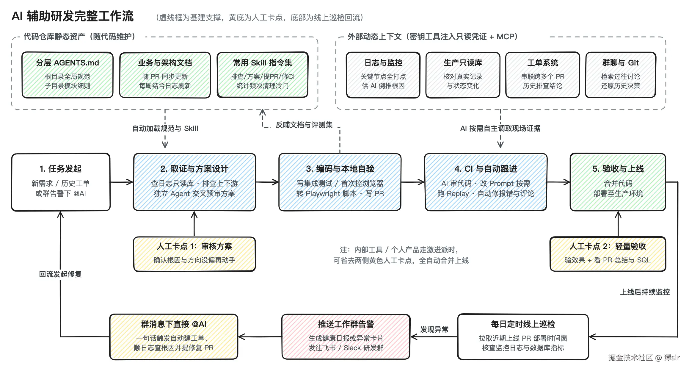
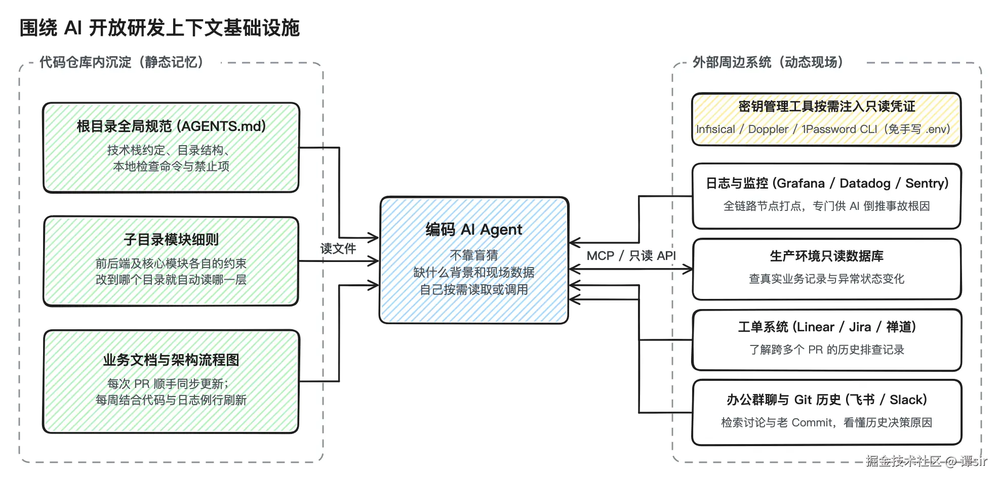

## AI Native

资深工程师能一眼分辨方案优劣，基础弱则只能依赖 AI 判断；知识广度尤其重要，知道有哪些概念和环节，才知道怎么向 AI 提问，“问题问得好，回答质量才高”

**核心：**

正确的、足够的上下文
明确的指示

**流程**

AI覆盖整个流程 = **AI工作流**

任务 -> 方案设计 -> 编码、自测 -> CI -> 验收上线

**稳健**：前期重审方案（多 Agent 审 + 人拍板），编码、回放、测试全交给 AI，最后人验效果（适合线上核心业务/ToB）

**激进**：人只发工单，AI 全自动做完直接合并（适合内部工具、个人产品或早期验证项目）

### 提示词

“具体要做什么、要求和限制是什么、可以参考仓库里的哪个文件、做完之后要满足什么验证条件，以及收尾要记得更新工单、补上必要的日志”

把这一整套排查要求提炼成一个 Skill

### 上下文
代码图谱
**工程知识**（技术栈、目录结构、CI 配置）放在根目录或子目录的 AGENTS.md 中
**业务知识** 知识库，PR同步更新，每周AI知识整理
**MCP接入外部** 日志监控（grafana、sentry）、只读数据库、办公软件、GIT历史

### Skill化
提炼Skill 按场景调用，定期清理保持精简
用结构化数据或代码约束的规则，不要堆在自然语言 Prompt 里

写方案的Skill
写代码的SKill
提交代码PR的Skill

### 测试 & CodeReview
AI代码快且量大，要用新方法验收
**测试** 对PR有回放，核心业务要有一套安全的replay，单元测试，集成测试，e2e测试
**review** 注释 精炼是否有必须要，格式是否规范，是否正确复用组件 。PR 描述与总结（现象、证据、根因、方案是否立得住）

接口请求慢 其实是网络协议的原因