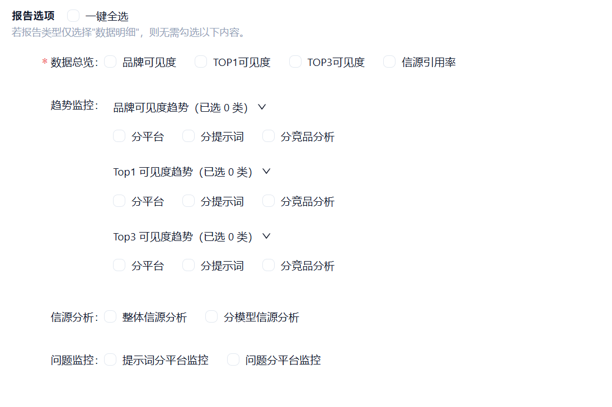
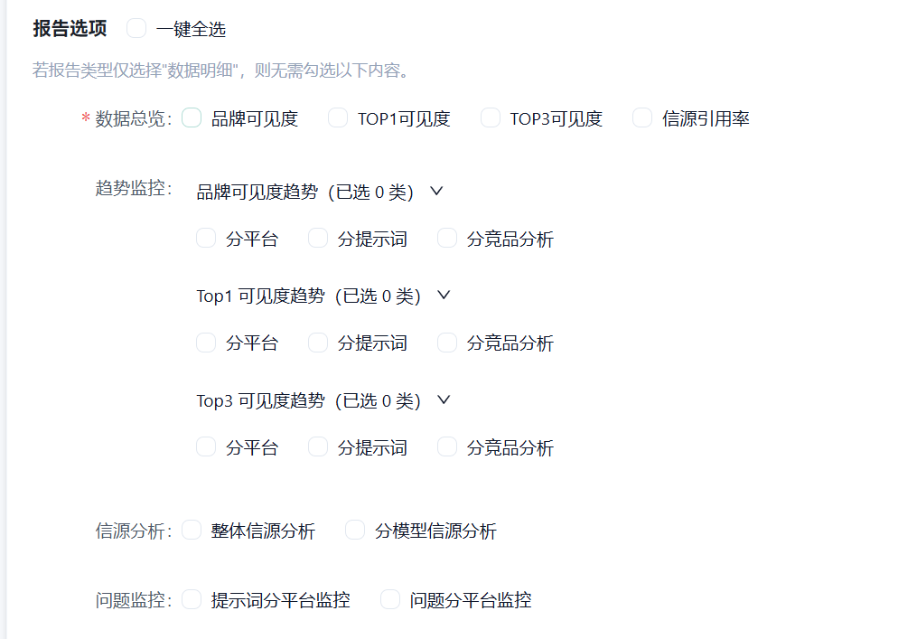
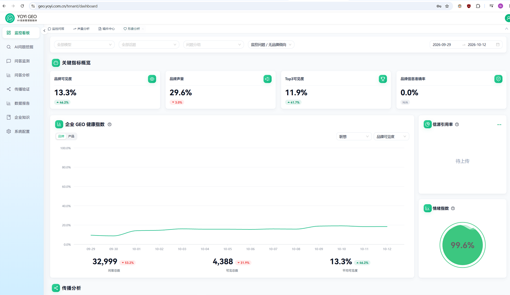
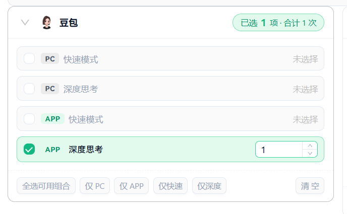
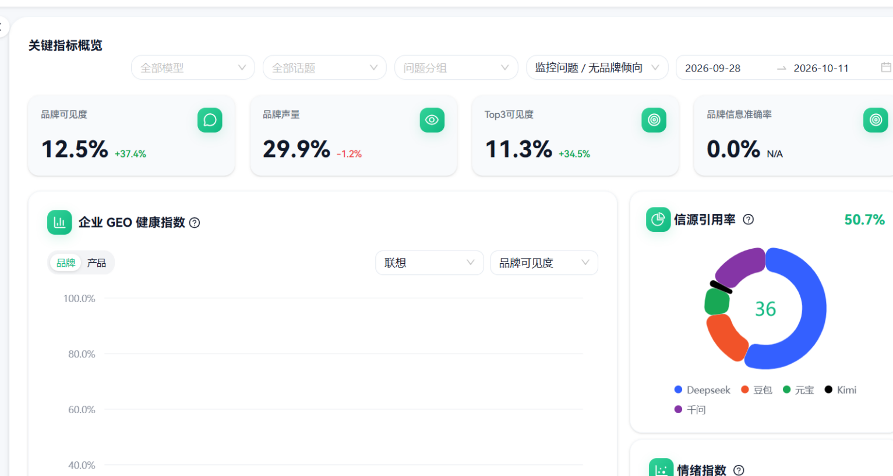

选项label和选项value要有区别度

布局Sider除了固定宽度外 也可以使用最大百分比+最小固定宽度的组合，不然在大屏下不好看

上下很窄的情况下，加减应该放到左右，否则用户很难交互
提供快速选择 是个好设计，但是加上更清晰的图标会更优秀 比如 仅PC → 🖥️PC / 仅快速 → ⚡️快速

不要卡片重叠卡片 阴影重叠阴影，数据没有立体感
标题要出去 让数据块的目的清晰

图片 图标 >>> 文字表述，合理的给标题等使用图标