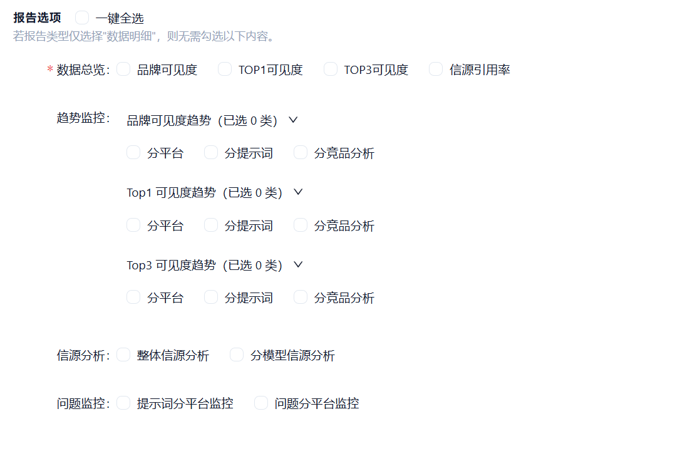
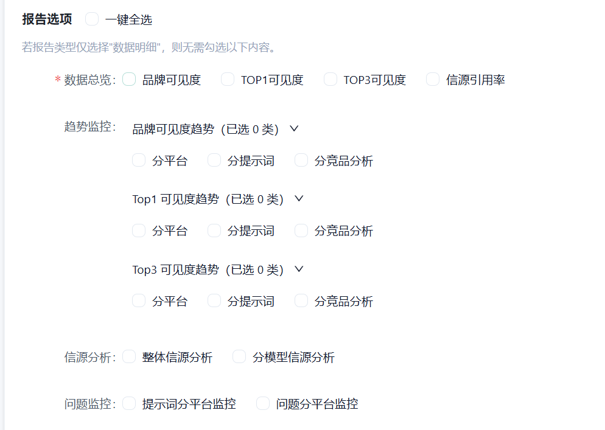
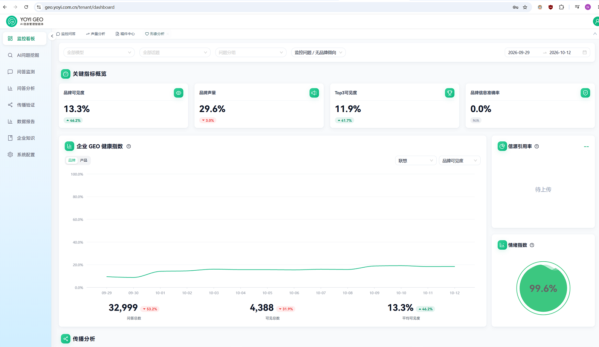
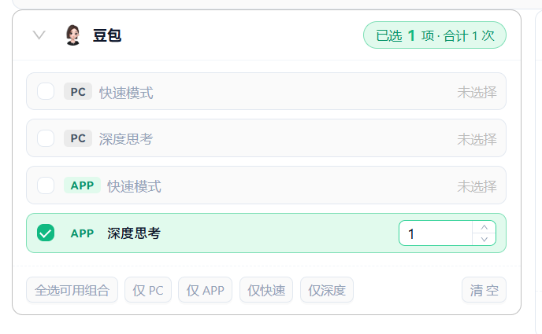
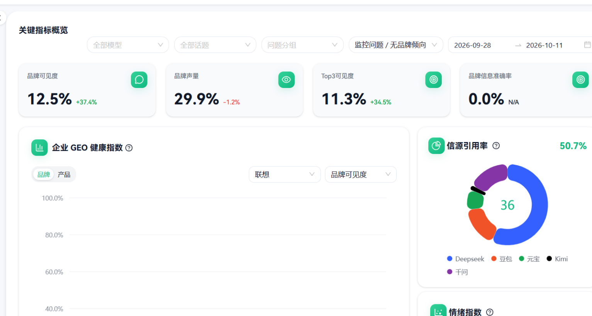
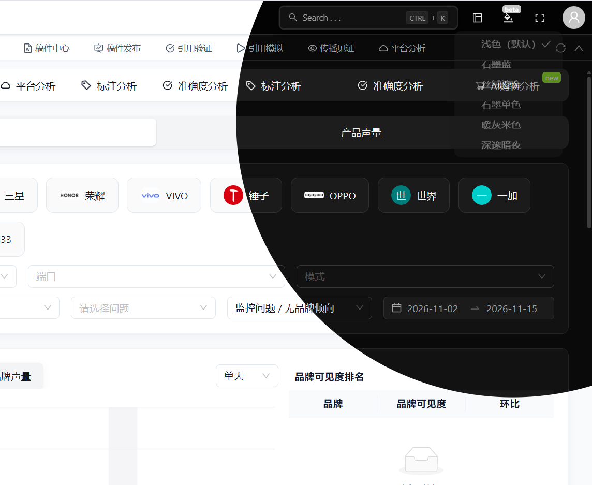
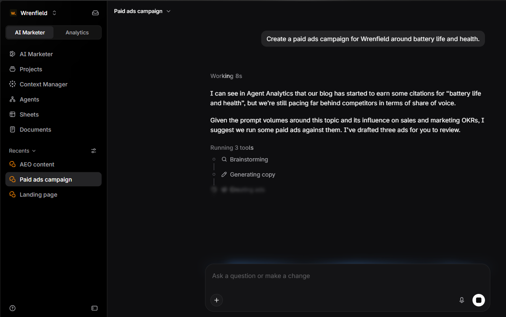
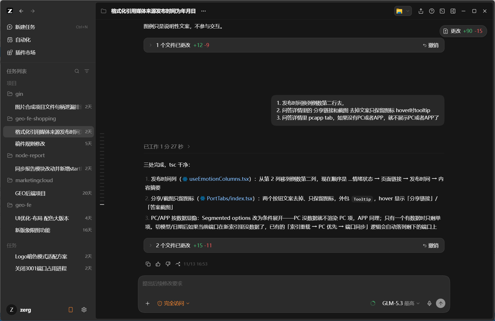
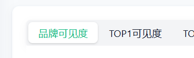
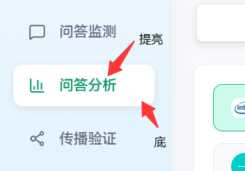

选项label和选项value要有区别度

布局Sider除了固定宽度外 也可以使用最大百分比+最小固定宽度的组合，不然在大屏下不好看

上下很窄的情况下，加减应该放到左右，否则用户很难交互
提供快速选择 是个好设计，但是加上更清晰的图标会更优秀 比如 仅PC → 🖥️PC / 仅快速 → ⚡️快速

不要卡片重叠卡片 阴影重叠阴影，数据没有立体感
标题要出去 让数据块的目的清晰

图片 图标 >>> 文字表述，合理的给标题等使用图标

颜色变化特别大的情况下，要有一个过渡方案

暗色**不能靠阴影**表达层级（阴影在深色上几乎不可见），要靠**背景亮度递增**。

控件圆角与容器圆角（UI设计中 圆角需要尽量克制 且控件圆角 与 容器圆角尽量递减，呈阶梯分级）

### 侧边栏设计
**选中态永远是「底 + 指示条 + 文字提亮」三者组合**，只改文字颜色在暗色下辨识度不够。
凹槽 = 轨道比容器暗、滑块比轨道亮，这套「深槽 + 亮块」在暗色下辨识度最高。

可以用color-scheme 让系统去处理 滚动 表格等能让系统配置的暗夜模式

### 视差滚动
使不同层次的元素以不同的速度进行滚动，创造出一种三维的视觉深度感。这种技术可以增强用户体验，使网页内容更加生动有趣。

background-attachment 和 transform:translate3D

### 过度动画

不要在高频的场景加入位移过多的 显眼的动画

核心理由：

**高频切换场景下，半秒级过渡会累积成真实等待；**

**不冗余** 选中态已提供足够导航反馈；

动画要表达真实的空间/因果/层级关系

**频率主导** 低频落地页动画可以营造仪式感；**高频切换必须低延迟、低干扰。交互越频繁，动效越应克制**